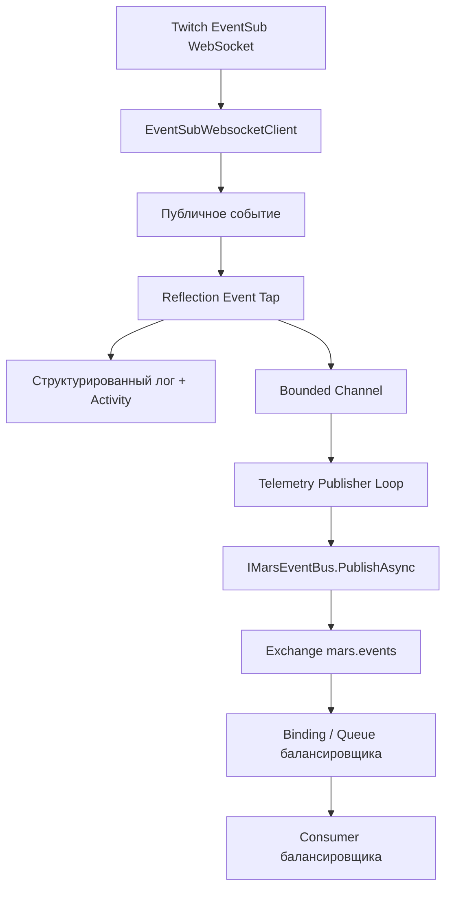

# План реализации телеметрии Twitch EventSub в MARS.TwitchCore

> **Назначение документа:** пошаговая инструкция для AI-агента, который самостоятельно реализует, проверяет и документирует отправку событий `TwitchLib.EventSub.Websockets` в RabbitMQ с логированием и распределённой трассировкой.
>
> **Репозиторий:** [RXDCODX/MARS](https://github.com/RXDCODX/MARS)  
> **Исходная область:** [`src/MARS.TwitchCore/Services/EventSub`](https://github.com/RXDCODX/MARS/tree/main/src/MARS.TwitchCore/Services/EventSub)  
> **Ветка, изученная при подготовке плана:** `main`. Перед реализацией проверь актуальное состояние рабочей ветки и не перезаписывай существующие изменения.

## 1. Обзор и цель

Реализуй централизованный перехват публичных событий `EventSubWebsocketClient`, чтобы каждое наблюдаемое событие сопровождалось структурированным логом, trace-контекстом и телеметрическим сообщением в существующем RabbitMQ event bus. Перехватчик должен обнаруживать события через reflection и не требовать ручной подписки на каждый тип Twitch EventSub. Используй инфраструктуру MARS (`IMarsEventBus`, `RabbitMqConfig`, `MarsActivities`, `MarsMetrics`), а не создавай параллельное RabbitMQ-соединение и отдельный формат телеметрии. Не блокируй обработку Twitch-событий сетевыми операциями, не меняй существующую бизнес-логику и сделай деградацию при переполнении очереди или недоступности RabbitMQ наблюдаемой.

## 2. Требования

### 2.1. Функциональные требования

| ID | Требование | Проверяемый критерий |
|---|---|---|
| FR-01 | Автоматически обнаруживай публичные instance-события `EventSubWebsocketClient` через reflection. | В тесте количество обработчиков совпадает с количеством совместимых событий, найденных reflection; имя каждого совместимого события появляется в отчёте перехватчика. |
| FR-02 | Перехватывай события жизненного цикла и типизированные уведомления: например, `WebsocketConnected`, `WebsocketDisconnected`, `WebsocketReconnected`, `ErrorOccurred`, `Revocation`, `ChannelChatMessage`, `ChannelFollow`, `StreamOnline`. | Отправка тестового события каждого выбранного класса создаёт envelope с правильным `eventName`. |
| FR-03 | Для каждого перехваченного вызова создавай один `EventSubTelemetryEnvelope`. | В штатном режиме число созданных envelope совпадает с числом перехваченных вызовов; переполнение очереди отражается отдельной метрикой и не происходит молча. |
| FR-04 | Публикуй телеметрию через `IMarsEventBus.PublishAsync`. | Тест проверяет routing key, сериализуемость контракта и ровно один вызов event bus на одно опубликованное сообщение. |
| FR-05 | Используй существующий exchange `mars.events` и добавь отдельный routing key для EventSub-телеметрии в `RabbitMqConfig`. | Маршрут не пересекается с `twitch.reward.*`, `twitch.message.*` или другими бизнес-событиями. |
| FR-06 | Записывай структурированный лог при перехвате и при ошибках публикации. | Лог содержит `eventName`, `messageId` при наличии, тип подписки и результат; payload и чувствительные данные не выводятся в лог. |
| FR-07 | Создавай Activity для входящего события с помощью существующего `MarsActivities.StartEventSubReceived` или расширенного метода того же класса. Добавляй ключевые атрибуты и `ActivityEvent`. | `ActivityListener` в тесте видит span/событие и ожидаемые низкокардинальные теги. |
| FR-08 | Передавай trace-контекст через очередь в publisher и далее через существующий `RabbitMqEventBus`. | В RabbitMQ headers сохраняется валидный W3C `traceparent`; publisher span является потомком контекста, снятого в момент приёма EventSub-события, если он был доступен. |
| FR-09 | Не сериализуй безусловно весь объект `EventArgs` в лог. Формируй envelope из стабильных метаданных, типизированного имени события и разрешённых полей. | Тест подтверждает отсутствие access token, refresh token и неразрешённых персональных данных в логах и дефолтном envelope. |
| FR-10 | Не выполняй RabbitMQ I/O внутри обработчика публичного события. | Перехватчик только извлекает метаданные, создаёт Activity/лог и делает неблокирующую попытку помещения envelope в ограниченную очередь. |
| FR-11 | Сделай включение/выключение телеметрии и размер очереди конфигурируемыми. | При `Enabled=false` обработчики не подписываются; некорректные значения опций валидируются при старте. |
| FR-12 | Корректно обрабатывай остановку приложения, повторный запуск сервиса и переподключение WebSocket. | Нет повторной подписки на одно и то же событие, необработанных исключений из фоновой задачи или повторного прикрепления tap к одному экземпляру клиента. |
| FR-13 | Проверь маршрут в балансировщик. | Установлен конкретный exchange/routing key/queue binding; если балансировщик находится вне этого репозитория, задокументируй точную требуемую конфигурацию вместо выдумывания имени очереди. |

### 2.2. Нефункциональные требования

1. **Изоляция бизнес-логики.** Сбой сериализации или публикации телеметрии не должен выбрасывать исключение в обработчик TwitchLib и ломать бизнес-обработчики.
2. **Неблокирующий callback.** Не вызывай и не ожидай `IMarsEventBus.PublishAsync` из обработчика события. Не жди сетевого ответа RabbitMQ в WebSocket-потоке.
3. **Ограниченная память.** Используй ограниченный `Channel<EventSubTelemetryEnvelope>` с настройкой `Capacity` и явной политикой переполнения. Не используй безлимитную очередь.
4. **Наблюдаемость потерь.** Считай очередь переполненной и каждое отброшенное telemetry-сообщение отдельной метрикой. Не маскируй переполнение уровнем `Debug` без агрегированной метрики.
5. **Ретраи.** В publisher используй повторные попытки с exponential backoff и верхним пределом задержки. Не запускай бесконечные параллельные задачи для каждого сообщения.
6. **Согласованность с MARS.** Используй существующий `RabbitMqEventBus`, `RabbitMqConfig.ExchangeName`, `MarsActivities` и `MarsMetrics`; не добавляй новые NuGet-зависимости без доказанной необходимости.
7. **Безопасность.** Не отправляй секреты, OAuth-токены и содержимое заголовков авторизации. По умолчанию не включай полный текст сообщений чата и произвольный payload в логи.
8. **Низкая кардинальность метрик.** Не используй `userId`, `messageId`, `sessionId`, текст сообщения или произвольный payload в metric tags.
9. **Совместимость.** Не изменяй существующие контракты `twitch.reward.*`, `twitch.message.*` и другие routing keys.
10. **Проверяемость.** Все новые классы должны тестироваться без действующего Twitch WebSocket и без обязательного внешнего RabbitMQ-брокера. Используй Moq и существующие тестовые шаблоны.

### 2.3. Важное ограничение доставки

Публичные события TwitchLib используют асинхронные multicast-delegate. У multicast delegate возвращаемым `Task` является задача последнего обработчика; нельзя считать, что TwitchLib ожидает `Task` всех обработчиков. Поэтому в baseline-реализации tap должен завершаться быстро и использовать `TryWrite`, не возвращая долгую асинхронную операцию, которая может остаться неawaited. При переполнении ограниченной очереди допускается потеря **только telemetry-сообщения**, если она явно отражена в метрике и warning-логе; бизнес-обработку не блокируй.

[ДОПУЩЕНИЕ] В этом плане телеметрия считается observability-потоком с best-effort доставкой в момент перегрузки, а не единственным журналом бизнес-событий. Если заказчик требует гарантированной доставки каждого события без потерь, не ослабляй очередь и не добавляй сетевые ожидания в callback: спроектируй отдельный durable outbox (локальное персистентное хранилище, replay, подтверждение публикации, очистка после подтверждения) и оцени это как отдельный обязательный этап. Ограниченная in-memory очередь не гарантирует сохранность при аварийном завершении процесса.

## 3. Технологический стек и зависимости

Используй версии, уже зафиксированные в репозитории; не повышай их в рамках этой задачи.

| Компонент | Текущая версия/реализация | Решение |
|---|---|---|
| .NET SDK | `global.json`: `10.0.100`, `rollForward: latestFeature` | Используй установленный SDK из репозитория. |
| Target framework TwitchCore | `net10.0-windows` | Сохрани target framework и текущие compiler settings. |
| C# | Версия, определяемая SDK и Target Framework | Используй nullable annotations и стиль проекта. |
| TwitchLib.EventSub.Websockets | `0.8.0` в `Directory.Packages.props` | Не форкай библиотеку для базового решения; подписывайся reflection на публичные события. |
| TwitchLib.EventSub.Core | `3.0.0` | Используй типы EventSub из уже установленной зависимости. |
| RabbitMQ.Client | `7.2.1` | Публикуй через `IMarsEventBus`, не создавай второй publisher/channel. |
| RabbitMQ event bus | `MARS.Shared.Messaging.IMarsEventBus` / `RabbitMqEventBus` | Переиспользуй существующие настройки, соединение, exchange и headers. |
| Tracing | OpenTelemetry `1.17.0`; `MARS.Shared.Telemetry.MarsActivities` | Используй существующий `ActivitySource` `MARS.Twitch.Events` и экспорт через уже настроенный OpenTelemetry. |
| Metrics | `MARS.Shared.Telemetry.MarsMetrics` | Добавляй инструменты в существующий `Meter` `MARS.Twitch`; соблюдай ограничения `OpenTelemetryPrometheusBridge`. |
| Configuration | `Microsoft.Extensions.Options` из ASP.NET Core | Создай options для `EventSubTelemetry`; пакет отдельно не добавляй. |
| Async queue | `System.Threading.Channels` из .NET | Применяй ограниченный channel. |
| Testing | `xunit.v3` `4.0.0`, Moq `4.20.72`, Microsoft Testing Platform | Следуй существующим тестовым соглашениям MARS. |

### 3.1. Изученные точки интеграции

Перед редактированием проверь актуальное состояние следующих файлов:

- [`src/MARS.TwitchCore/Program.cs`](https://github.com/RXDCODX/MARS/blob/main/src/MARS.TwitchCore/Program.cs) — `EventSubWebsocketClient` уже зарегистрирован как singleton; там же регистрируются hosted services.
- [`src/MARS.TwitchCore/Services/EventSub/EventSubService.cs`](https://github.com/RXDCODX/MARS/blob/main/src/MARS.TwitchCore/Services/EventSub/EventSubService.cs) — подключение, переподключение и управление Twitch EventSub subscriptions.
- [`src/MARS.TwitchCore/Services/Rewards/RewardRedemptionPublisher.cs`](https://github.com/RXDCODX/MARS/blob/main/src/MARS.TwitchCore/Services/Rewards/RewardRedemptionPublisher.cs) — пример подписки на публичное событие и публикации через event bus.
- [`src/MARS.Shared/Messaging/IMarsEventBus.cs`](https://github.com/RXDCODX/MARS/blob/main/src/MARS.Shared/Messaging/IMarsEventBus.cs) — абстракция публикации.
- [`src/MARS.Shared/Messaging/RabbitMqEventBus.cs`](https://github.com/RXDCODX/MARS/blob/main/src/MARS.Shared/Messaging/RabbitMqEventBus.cs) — текущая реализация публикации в exchange `mars.events`; устанавливает `traceparent`, `tracestate`, `mars.source_service` и timestamp в AMQP headers.
- [`src/MARS.Shared/Messaging/RabbitMqConfig.cs`](https://github.com/RXDCODX/MARS/blob/main/src/MARS.Shared/Messaging/RabbitMqConfig.cs) — центральные exchange и routing keys.
- [`src/MARS.Shared/Telemetry/MarsActivities.cs`](https://github.com/RXDCODX/MARS/blob/main/src/MARS.Shared/Telemetry/MarsActivities.cs) — содержит `StartEventSubReceived` и источники Activity.
- [`src/MARS.Shared/Telemetry/MarsMetrics.cs`](https://github.com/RXDCODX/MARS/blob/main/src/MARS.Shared/Telemetry/MarsMetrics.cs) — существующие метрики Twitch и RabbitMQ.
- [`src/MARS.Shared/Telemetry/OpenTelemetryExtensions.cs`](https://github.com/RXDCODX/MARS/blob/main/src/MARS.Shared/Telemetry/OpenTelemetryExtensions.cs) — tracing уже включает источники `MARS.*` и OTLP exporter.
- [`tests/MARS.TwitchCore.Tests/Services/EventSubServiceTests.cs`](https://github.com/RXDCODX/MARS/blob/main/tests/MARS.TwitchCore.Tests/Services/EventSubServiceTests.cs) и `OfflineEventSub.cs` — шаблон тестирования без реального подключения к Twitch.
- [`tests/MARS.Shared.Tests/Messaging/RabbitMqEventBusTests.cs`](https://github.com/RXDCODX/MARS/blob/main/tests/MARS.Shared.Tests/Messaging/RabbitMqEventBusTests.cs) — шаблон проверки RabbitMQ publisher через mock channel.

## 4. Архитектура решения

### 4.1. Компоненты

1. **`EventSubTelemetryOptions`** — настройки включения, размера очереди, payload-политики и shutdown timeout.
2. **`EventSubTelemetryEnvelope`** — стабильный контракт телеметрического сообщения, не зависящий от конкретного класса `EventArgs`.
3. **`EventSubTelemetryBuffer`** — ограниченный `Channel<EventSubTelemetryEnvelope>`, API помещения и чтения, учёт переполнения.
4. **`EventSubEventTap`** — reflection-обнаружение публичных событий и генерация делегатов подходящей сигнатуры; извлекает метаданные, формирует Activity/лог и быстро кладёт envelope в buffer.
5. **`EventSubTelemetryService`** — lifecycle-координатор: прикрепляет tap до подключения WebSocket, запускает publisher loop, при остановке отсоединяет обработчики и завершает drain очереди в пределах timeout.
6. **`IMarsEventBus`** — передаёт сообщения в уже настроенный RabbitMQ exchange `mars.events`.
7. **`RabbitMqConfig`** — задаёт уникальный routing key для EventSub telemetry.
8. **`MarsActivities` / `MarsMetrics`** — поддерживают trace spans/events и метрики захвата, публикации, ошибок и переполнений.
9. **Consumer/balancer** — принимает маршрут EventSub telemetry. Найди существующую очередь и binding в репозитории/compose/deployment; если балансировщик внешний, задокументируй требуемый binding для его конфигурации.

### 4.2. Поток обработки



### 4.3. Структура файлов

Создай минимально необходимую структуру; не вводи новые проекты и не перемещай действующие классы без причины.

```text
src/MARS.TwitchCore/
├── Configuration/
│   └── EventSubTelemetryOptions.cs               [новый]
├── Services/
│   └── EventSub/
│       ├── EventSubService.cs                     [существующий; менять только при необходимости]
│       └── Telemetry/
│           ├── EventSubTelemetryEnvelope.cs       [новый]
│           ├── EventSubTelemetryBuffer.cs         [новый]
│           ├── EventSubEventTap.cs                [новый]
│           └── EventSubTelemetryService.cs        [новый]
├── Program.cs                                     [изменить: DI и options]
└── appsettings.json                               [изменить: безопасные значения по умолчанию]

src/MARS.Shared/
├── Messaging/RabbitMqConfig.cs                    [изменить: routing key]
└── Telemetry/
    ├── MarsActivities.cs                          [изменить только при необходимости]
    └── MarsMetrics.cs                             [изменить: counters для telemetry]

tests/MARS.TwitchCore.Tests/
└── Services/EventSub/
    ├── EventSubEventTapTests.cs                   [новый]
    ├── EventSubTelemetryServiceTests.cs            [новый]
    └── EventSubTelemetryPublisherTests.cs         [новый либо объединить по стилю проекта]

tests/MARS.Shared.Tests/
└── Messaging/RabbitMqEventBusTests.cs             [не менять без необходимости; добавить тест лишь если меняется общий bus]
```

Если папки `tests/MARS.TwitchCore.Tests/Services/EventSub` нет, создай её. Сначала посмотри существующий стиль namespace, Moq и `TestContext.Current.CancellationToken`; не копируй устаревшие patterns.

### 4.4. Регистрация DI и lifecycle

- Оставь `EventSubWebsocketClient` singleton — он уже так зарегистрирован в `Program.cs`.
- Зарегистрируй `EventSubTelemetryOptions` через `Configure`/`AddOptions` и валидацию.
- Зарегистрируй `EventSubTelemetryBuffer` как singleton.
- Зарегистрируй `EventSubTelemetryService` как singleton и hosted service через фабрику, если нужно использовать один экземпляр: `AddSingleton<EventSubTelemetryService>(); AddHostedService(sp => sp.GetRequiredService<EventSubTelemetryService>());`.
- Зарегистрируй hosted service **до** `EventSubService` и остальных hosted services, подписывающихся на EventSub: tap должен быть подключён до того, как клиент начнёт получать события.
- В `StartAsync` прикрепи tap до запуска publisher loop либо перед возвратом из `StartAsync` убедись, что все делегаты подключены. Не вызывай `ConnectAsync` в telemetry service.
- При остановке сначала прекрати получать новые события (отпишись от всех event handlers), завершай writer и выполни ограниченный drain. Не используй `async void`.
- Обеспечь идемпотентность `Attach`/`Detach`. Не прикрепляй повторные handlers при WebSocket reconnect: библиотека сохраняет внешний `EventSubWebsocketClient`, а переподключает underlying socket.

## 5. Пошаговый план реализации

### Этап 1. Подтверди текущую архитектуру и контракт балансировщика

**Задачи**

1. Открой перечисленные выше исходники в текущей рабочей ветке.
2. Найди определение `IMarsEventBus`, регистрацию `RabbitMqEventBus`, секцию `RabbitMq`, общий exchange и существующие consumer bindings.
3. Поиск по репозиторию выполни по словам `balance`, `balancer`, `load balancer`, `twitch.eventsub`, `RabbitMqConfig.ExchangeName`, `QueueBindAsync`, `mars.events`.
4. Определи, какой сервис должен получать сообщение, какая у него очередь и какой routing key pattern настроен.
5. Если consumer расположен вне `RXDCODX/MARS`, не создавай произвольное имя очереди. Зафиксируй в итоговом отчёте, что на стороне владельца балансировщика нужно добавить binding для согласованного routing key.

**Файлы**

- Только чтение на этом этапе.

**Definition of Done**

- Зафиксированы актуальные `TargetFramework`, пакетные версии, RabbitMQ exchange и место DI-регистрации.
- Есть подтверждённый route/binding или явно записан открытый вопрос о внешнем consumer.
- Нет предположения, что `mars.events` автоматически доставляет сообщение в нужную очередь: exchange сам по себе не создаёт binding.

**Ожидаемый результат**

Короткое архитектурное решение, на основании которого можно выбрать новый routing key без нарушения существующих бизнес-событий.

### Этап 2. Определи контракт `EventSubTelemetryEnvelope`

**Задачи**

1. Создай `EventSubTelemetryEnvelope.cs`.
2. Используй явные JSON-имена и стабильную схему, не сериализуй весь `EventArgs` автоматически как контракт.
3. Добавь `SchemaVersion`, `EventId`, `ObservedAtUtc`, `SourceService`, `EventName`, `EventArgsType`, `SessionId`, метаданные Twitch EventSub и trace context.
4. Извлекай поля, которых может не быть у lifecycle-событий, как nullable.
5. Предусмотри необязательный payload только через опцию; по умолчанию payload отсутствует или ограничен allowlist-ом.
6. Ограничь сериализованный payload через `MaxPayloadBytes`. Не пытайся обрезать JSON произвольной строкой так, чтобы получился невалидный JSON; вместо этого пропускай payload или клади признак `payloadOmittedReason`.

**Файлы**

- `src/MARS.TwitchCore/Services/EventSub/Telemetry/EventSubTelemetryEnvelope.cs`.

**Definition of Done**

- Envelope сериализуется с `System.Text.Json` в стабильный JSON.
- Контракт работает для lifecycle event без `Metadata` и typed notification с `Metadata`/`Payload`.
- В контракте нет OAuth secret/token, полных данных конфигурации или произвольных объектов `IServiceProvider`.

**Ожидаемый результат**

Версионируемый DTO, который можно принимать в другом сервисе без ссылки на TwitchLib EventArgs assemblies.

### Этап 3. Добавь настройки телеметрии

**Задачи**

1. Создай `EventSubTelemetryOptions.cs`.
2. Задай минимум поля: `Enabled`, `QueueCapacity`, `IncludePayload`, `MaxPayloadBytes`, `ShutdownDrainTimeoutSeconds`.
3. Выбери разумные значения по умолчанию: `Enabled=true`, очередь `4096`, `IncludePayload=false`, максимальный payload `16384` байт, shutdown drain timeout `5` секунд. Сделай эти значения документированными и изменяемыми через конфигурацию.
4. Включи options validation: `QueueCapacity > 0`, `MaxPayloadBytes >= 0`, `ShutdownDrainTimeoutSeconds > 0`.
5. Добавь секцию `EventSubTelemetry` в `src/MARS.TwitchCore/appsettings.json`. Не добавляй секреты или connection string RabbitMQ в новую секцию.

**Файлы**

- `src/MARS.TwitchCore/Configuration/EventSubTelemetryOptions.cs`.
- `src/MARS.TwitchCore/appsettings.json`.
- `src/MARS.TwitchCore/Program.cs`.

**Definition of Done**

- Значения читаются через DI и проверяются при старте.
- `Enabled=false` отключает подписку, а не только публикацию.
- Новых NuGet-пакетов нет.

**Ожидаемый результат**

Предсказуемая конфигурация, позволяющая безопасно включать/отключать телеметрию и менять лимиты без перекомпиляции.

### Этап 4. Реализуй bounded buffer и политику перегрузки

**Задачи**

1. Создай `EventSubTelemetryBuffer.cs` с `Channel<EventSubTelemetryEnvelope>` и `BoundedChannelOptions`.
2. Используй `SingleReader=true`, `AllowSynchronousContinuations=false`; `SingleWriter` устанавливай только если тесты и вызовы гарантируют единственного writer.
3. Для baseline observability-режима используй `TryWrite` из синхронно-быстрого callback. Если очередь заполнена, увеличивай counter dropped и делай rate-limited warning; не выбрасывай исключение в TwitchLib.
4. Экспортируй `ChannelReader` для publisher loop, не раскрывай writer произвольным потребителям.
5. Добавь завершение writer и корректное поведение при записи после завершения.
6. Не используй fire-and-forget отдельной Task на каждое событие.

**Файлы**

- `src/MARS.TwitchCore/Services/EventSub/Telemetry/EventSubTelemetryBuffer.cs`.

**Definition of Done**

- Очередь имеет фиксированную вместимость.
- При заполнении данные не удерживаются в памяти без границ, dropped counter увеличивается.
- Ошибка помещения в закрытую очередь не выходит наружу в бизнес-обработчик.

**Ожидаемый результат**

Изолированный и тестируемый механизм передачи сообщений от EventSub callback к publisher loop.

### Этап 5. Реализуй reflection tap публичных событий

**Задачи**

1. Создай `EventSubEventTap.cs`.
2. Используй `typeof(EventSubWebsocketClient).GetEvents(BindingFlags.Instance | BindingFlags.Public)`.
3. Принимай только delegate types, у которых `Invoke` возвращает `Task`, имеет два параметра и совместимую сигнатуру `(object? sender, TEventArgs args)`. Для неподдерживаемых событий пропускай подписку с диагностическим логом, а не падай при старте.
4. Создавай handler динамически через `Expression` или другой типобезопасный reflection helper. Не генерируй отдельный код под каждое имя события.
5. Для каждого события формируй `eventName` из `EventInfo.Name`. Извлекай через reflection только согласованные public metadata properties: `Metadata`, `MessageId`, `MessageType`, `SubscriptionType`, `SubscriptionVersion` и другие существующие поля; значения могут отсутствовать.
6. Прикрепляй обработчики идемпотентно и храни пары `(EventInfo, Delegate)` для последующего `RemoveEventHandler`.
7. В callback используй `MarsActivities.StartEventSubReceived(eventName)` или расширенный метод; устанавливай атрибуты и добавляй `ActivityEvent` с безопасными scalar tags. Логируй поля структурированно, не выводя payload.
8. Захватывай `Activity.Current?.Id` и `TraceStateString` до завершения span. Сериализуй этот trace context в envelope, чтобы восстановить родительский контекст вне callback.
9. Завершай callback быстро и возвращай завершённый `Task`. Не await-ь `IMarsEventBus`, не выполняй HTTP/RabbitMQ I/O и не сериализуй сложную payload-модель целиком при каждом callback.
10. Не делай reflection по приватным полям TwitchLib и не пытайся перехватывать вызов private `HandleNotificationAsync`: private method invocation не перехватывается обычной reflection-подпиской.

**Файлы**

- `src/MARS.TwitchCore/Services/EventSub/Telemetry/EventSubEventTap.cs`.
- Возможно `src/MARS.Shared/Telemetry/MarsActivities.cs`, если потребуются новые атрибуты/метод; сохраняй совместимость существующих методов.

**Definition of Done**

- Tap обнаруживает события автоматически и не содержит hardcoded список всех Twitch subscription types.
- Ошибка при обработке одного event args не ломает следующие события.
- Повторный `Attach` не дублирует handlers; `Detach` удаляет все добавленные handlers.
- Callback не делает сетевого I/O и не возвращает незавершённую задачу от publisher.

**Ожидаемый результат**

Один reusable компонент для наблюдения публичной поверхности EventSubWebsocketClient, независимо от конкретных типов уведомлений.

### Этап 6. Реализуй publisher loop и передачу trace-контекста

**Задачи**

1. В `EventSubTelemetryService` или отдельном внутреннем publisher компоненте запусти один reader loop, который читает `EventSubTelemetryBuffer`.
2. Публикуй через `IMarsEventBus.PublishAsync(RabbitMqConfig.EventSubTelemetryObserved, envelope, cancellationToken)`.
3. Не создавай собственный `ConnectionFactory`, `IConnection` или `IChannel`: они принадлежат `RabbitMqEventBus`.
4. Перед вызовом event bus восстанови captured `ActivityContext` из `TraceParent`/`TraceState`, создав parent Activity в `MarsActivities.TwitchSource` или использовав существующий tracing helper. Не создавай trace с чужим/невалидным parent; в этом случае начни root span и сохрани исходный invalid/missing context как диагностическое поле только при необходимости.
5. Проверь, что `RabbitMqEventBus` создаёт producer span и помещает `traceparent`/`tracestate` в AMQP headers; не дублируй эти функции в новом классе.
6. При временной ошибке публикации повторяй отправку с exponential backoff и максимальной задержкой. Не запускай бесконечно много задач и не теряй исключения. Учитывай shutdown cancellation.
7. Логируй успешную публикацию на Debug/Trace уровне, ошибки — Warning/Error с routing key и event id, но без payload.
8. Не меняй общие retry semantics `RabbitMqEventBus`, если задачу можно выполнить локально в telemetry publisher.

**Файлы**

- `src/MARS.TwitchCore/Services/EventSub/Telemetry/EventSubTelemetryService.cs`.
- `src/MARS.Shared/Telemetry/MarsActivities.cs` — только если нужно расширить helper.

**Definition of Done**

- Все сообщения из buffer читаются одним pump и публикуются через `IMarsEventBus`.
- Повторная ошибка публикации не вызывает параллельного storm из Tasks.
- В публикуемом envelope сохранён trace context события; AMQP producer headers формирует общий event bus.

**Ожидаемый результат**

Асинхронная передача EventSub-телеметрии в RabbitMQ с корреляцией входящего события и публикации.

### Этап 7. Добавь routing key и observability-метрики

**Задачи**

1. В `RabbitMqConfig` добавь стабильный routing key, например `twitch.eventsub.observed`, если этап 1 не выявил согласованный уже существующий маршрут.
2. Используй единый routing key для всего telemetry stream; событие конкретного типа различай полем `eventName` в envelope. Не делай динамический routing key из пользовательских данных.
3. В `MarsMetrics` добавь counters для перехваченных событий, успешных публикаций, ошибок и отброшенных сообщений из-за переполнения. При необходимости добавь histogram времени обработки/очереди.
4. Не добавляй высококардинальные метки. Если метрика имеет tags, объяви разрешённые имена тегов при создании инструмента и соблюдай соглашения `OpenTelemetryPrometheusBridge`.
5. Используй существующие `TwitchSource` и `RabbitMqSource`; `OpenTelemetryExtensions` уже подключает `MARS.*` к tracing pipeline. Не регистрируй второй OTel provider.

**Файлы**

- `src/MARS.Shared/Messaging/RabbitMqConfig.cs`.
- `src/MARS.Shared/Telemetry/MarsMetrics.cs`.
- Возможно `src/MARS.Shared/Telemetry/MarsActivities.cs`.

**Definition of Done**

- Routing key уникален и не пересекается с бизнес-маршрутами.
- Метрики имеют единый low-cardinality schema и появляются в существующей системе сбора метрик.
- В трассировке виден EventSub span и последующая публикация RabbitMQ при наличии sampling/listener.

**Ожидаемый результат**

Согласованный маршрут и метрики, позволяющие увидеть состояние перехватчика и потери телеметрии.

### Этап 8. Подключи жизненный цикл через DI

**Задачи**

1. В `Program.cs` зарегистрируй options, buffer и telemetry service.
2. Зарегистрируй hosted service с тем же singleton instance до `EventSubService` и до hosted services, подписывающихся на публичные EventSub events.
3. Перед запуском publisher loop прикрепи reflection handlers; на `Enabled=false` не подписывайся.
4. При остановке отсоедини все handlers, закрой очередь и попробуй drained delivery в пределах `ShutdownDrainTimeoutSeconds`. Если timeout истёк, залогируй сколько сообщений осталось/не подтверждено; не задерживай завершение процесса бесконечно.
5. Убедись, что существующие `RewardRedemptionPublisher`, `TwitchMessagesPublisher` и другие consumers сохраняют прежние события и работают без изменений публичных контрактов.
6. Убедись, что singleton `EventSubWebsocketClient` не создаётся повторно внутри telemetry-сервиса.

**Файлы**

- `src/MARS.TwitchCore/Program.cs`.
- `src/MARS.TwitchCore/Services/EventSub/Telemetry/EventSubTelemetryService.cs`.

**Definition of Done**

- DI validation проходит с текущими настройками проекта.
- Tap подключён до первого возможного WebSocket event.
- Старт/остановка не вызывает двойную регистрацию, ObjectDisposedException или оставшиеся handlers.

**Ожидаемый результат**

Телеметрия запускается вместе с `MARS.TwitchCore` и корректно завершается вместе с хостом.

### Этап 9. Добавь тесты

**Задачи**

1. Создай unit tests для reflection discovery, envelope mapping, queue overflow, attach/detach, `Enabled=false`, publisher retry и graceful shutdown.
2. Используй `OfflineEventSub.Create()` как клиент без сети и `Mock<IMarsEventBus>` как publisher dependency.
3. Не подключай тесты к Twitch API, реальному WebSocket или RabbitMQ.
4. Для событий вызывай публичный event delegate тестовым методом либо используй настоящий публичный EventSub event типа `WebsocketConnected` с соответствующим args объектом.
5. Используй `ActivityListener`, чтобы проверить создание Activity и сохранение trace context.
6. Добавь контрактный тест routing key и JSON schema/version.

**Файлы**

- `tests/MARS.TwitchCore.Tests/Services/EventSub/EventSubEventTapTests.cs`.
- `tests/MARS.TwitchCore.Tests/Services/EventSub/EventSubTelemetryServiceTests.cs`.
- `tests/MARS.TwitchCore.Tests/Services/EventSub/EventSubTelemetryPublisherTests.cs`.
- Другие тесты меняй только при необходимости.

**Definition of Done**

- Новые тесты проходят через тестовый runner, определённый `global.json`.
- Тесты детерминированы, не зависят от реальных секретов, сети, задержек или RabbitMQ.
- Проверены успешный путь и все перечисленные граничные случаи.

**Ожидаемый результат**

Регрессионное покрытие новых классов и доказательство, что telemetry-path не ломает существующую EventSub-интеграцию.

### Этап 10. Выполни self-review, тесты и документацию

**Задачи**

1. Выполни format/analyzer commands, принятые в репозитории.
2. Выполни `dotnet test tests/MARS.TwitchCore.Tests/MARS.TwitchCore.Tests.csproj` и `dotnet test tests/MARS.Shared.Tests/MARS.Shared.Tests.csproj`.
3. Выполни сборку затронутых проектов и/или команду CI из `.github/workflows/ci.yml`; не объявляй проверку успешной без фактического результата.
4. Проверь diff на секреты, высококардинальные metric tags, изменение существующих routing keys, нарушения nullable и предупреждения (оба csproj используют `TreatWarningsAsErrors`).
5. Обнови комментарии или документацию о routing key, envelope schema и конфигурации. Если балансировщик внешний, добавь точную binding-инструкцию в итоговый отчёт.

**Файлы**

- Все созданные/изменённые в этапах 2–9.
- При необходимости короткий раздел документации по конфигурации.

**Definition of Done**

- Сборка и целевые тесты фактически завершены; ошибки перечислены, а не скрыты.
- Изменения ограничены реализацией EventSub telemetry.
- Финальный отчёт содержит изменённые файлы, команды проверки, результаты и известные ограничения.

**Ожидаемый результат**

Готовая к review реализация с понятным результатом проверок.

## 6. Контракты и интерфейсы

### 6.1. `EventSubTelemetryEnvelope`

Используй версионируемый контракт следующего вида. Имена JSON-полей должны быть стабильными и явно закреплены атрибутами либо настройками serializer.

```csharp
public sealed record EventSubTelemetryEnvelope
{
    public int SchemaVersion { get; init; } = 1;
    public required string EventId { get; init; }
    public required DateTimeOffset ObservedAtUtc { get; init; }
    public required string SourceService { get; init; } // MARS.TwitchCore
    public required string EventName { get; init; }    // CLR event name
    public required string EventArgsType { get; init; }

    public string? SessionId { get; init; }
    public string? MessageId { get; init; }
    public string? MessageType { get; init; }
    public string? SubscriptionType { get; init; }
    public string? SubscriptionVersion { get; init; }
    public string? SubscriptionId { get; init; }
    public DateTimeOffset? TwitchMessageTimestamp { get; init; }

    public string? TraceParent { get; init; }
    public string? TraceState { get; init; }

    public JsonElement? Payload { get; init; }
    public bool PayloadOmitted { get; init; }
    public string? PayloadOmittedReason { get; init; }
}
```

**Правила заполнения**

- `EventId`: используй Twitch `messageId`, если он присутствует и уникален для сообщения; для lifecycle event без такого ID создай `Guid` в формате `N`. Если нужен идентификатор вызова, отличный от ID Twitch-сообщения, добавь отдельное поле `InvocationId` и не смешивай семантику.
- `ObservedAtUtc`: время перехвата на стороне MARS, UTC. Сохраняй исходный timestamp Twitch отдельно, если он доступен.
- `EventName`: имя публичного CLR event (например `ChannelChatMessage`), не подставляй пользовательские данные в имя.
- `SubscriptionType` и `SubscriptionVersion`: исходные значения Twitch metadata, если присутствуют. Для lifecycle events оставляй `null`.
- `TraceParent` и `TraceState`: зафиксируй `Activity.Current` до выхода из tap callback. Если Activity не создана, сохраняй `null`.
- `Payload`: по умолчанию `null`; включай только при `IncludePayload=true` и после redaction/allowlist. Не сериализуй весь объект `EventArgs` как непрозрачный объект.

Пример JSON:

```json
{
  "schemaVersion": 1,
  "eventId": "5a8f1e2d32f74fd9adab3452ad8f7e20",
  "observedAtUtc": "2026-10-23T12:00:00Z",
  "sourceService": "MARS.TwitchCore",
  "eventName": "ChannelChatMessage",
  "eventArgsType": "TwitchLib.EventSub.Core.EventArgs.Channel.ChannelChatMessageArgs",
  "sessionId": "session-id-if-available",
  "messageId": "twitch-message-id-if-available",
  "messageType": "notification",
  "subscriptionType": "channel.chat.message",
  "subscriptionVersion": "1",
  "subscriptionId": "subscription-id-if-available",
  "traceParent": "00-<trace-id>-<span-id>-01",
  "traceState": null,
  "payload": null,
  "payloadOmitted": true,
  "payloadOmittedReason": "disabled_by_configuration"
}
```

Значения в примере — иллюстративные, а не реальные Twitch IDs.

### 6.2. Routing key и RabbitMQ

Добавь в `MARS.Shared.Messaging.RabbitMqConfig` стабильную константу, если на этапе 1 не найден уже утверждённый маршрут:

```csharp
public const string EventSubTelemetryObserved = "twitch.eventsub.observed";
```

В publisher вызывай:

```csharp
await eventBus.PublishAsync(
    RabbitMqConfig.EventSubTelemetryObserved,
    envelope,
    cancellationToken);
```

Используй текущий `RabbitMqConfig.ExchangeName` (`mars.events`). Сначала подтверди binding на queue балансировщика: сообщение в topic exchange не попадёт в очередь без подходящего binding. Не создавай новую очередь в `MARS.TwitchCore` только ради публикации, если в проекте очередь балансировщика уже владеется другим сервисом.

### 6.3. Activity и корреляция

- Начинай Activity через `MarsActivities.StartEventSubReceived(eventName)` либо добавь overload, который принимает metadata.
- Добавь scalar tags: `twitch.event_name`, `twitch.message_type`, `twitch.subscription_type`, `twitch.subscription_version`, `messaging.system` и `service.name` при необходимости.
- Добавь `ActivityEvent` вроде `eventsub.received` с безопасными tags и временем приёма.
- Не добавляй `userId`, message body, полный payload или credential в tags.
- Переноси W3C context в envelope, потому что публикация выполняется позже из фонового consumer loop и `Activity.Current` не обязан сохраняться автоматически.
- В publisher восстанови captured parent context перед вызовом `IMarsEventBus.PublishAsync`. Существующий `RabbitMqEventBus` создаёт producer Activity и переносит контекст в `traceparent`/`tracestate` AMQP headers.

### 6.4. Конфигурация

Пример секции `appsettings.json`:

```json
{
  "EventSubTelemetry": {
    "Enabled": true,
    "QueueCapacity": 4096,
    "IncludePayload": false,
    "MaxPayloadBytes": 16384,
    "ShutdownDrainTimeoutSeconds": 5
  }
}
```

Добавляй секцию аккуратно в существующий JSON, не заменяя другие настройки. Реализуй strongly typed options. Если в `appsettings.Development.json`/production env templates нужен override, обнови их без секретов.

### 6.5. Метрики

Добавь или адаптируй следующие инструменты в `MarsMetrics` без high-cardinality tags:

- `mars.twitch.eventsub.telemetry.captured` — количество перехваченных вызовов.
- `mars.twitch.eventsub.telemetry.published` — количество сообщений, успешно переданных event bus.
- `mars.twitch.eventsub.telemetry.publish_errors` — ошибки публикации/сериализации.
- `mars.twitch.eventsub.telemetry.dropped` — сообщения, не помещённые в channel из-за переполнения.
- По необходимости `mars.twitch.eventsub.telemetry.queue_delay_ms` — задержка между observation и публикацией.

Не создавай дублирующий инструмент, если в текущей ветке эти метрики уже добавлены кем-то другим. Соблюдай правила `MarsMetrics`: имя каждой tag dimension должно быть объявлено в создании инструмента, если она используется.

## 7. Стратегия тестирования

### 7.1. Unit tests для reflection tap

Напиши тесты:

1. `Attach_FindsPublicAsyncEvents`: tap обнаруживает публичные совместимые event handlers.
2. `Attach_IsIdempotent`: повторный `Attach` не приводит к двум telemetry envelope на один вызов.
3. `Detach_RemovesHandlers`: после `Detach` новые события не наблюдаются.
4. `LifecycleEvent_ProducesEnvelopeWithoutMetadata`: `WebsocketConnected` создаёт envelope с `EventName`, а поля subscription остаются `null`.
5. `NotificationEvent_ExtractsMetadata`: typed notification копирует MessageId, SubscriptionType и Version, если они присутствуют в модели.
6. `UnsupportedSignature_IsSkipped`: событие с неподдерживаемой delegate signature не вызывает аварийный выход на старте.
7. `SerializationFailure_DoesNotEscapeCallback`: ошибка создания payload/envelope не выбрасывается наружу и учитывается как telemetry failure.
8. `PayloadIsExcludedByDefault`: default options не включают тело сообщения.
9. `PayloadOverLimit_IsOmitted`: payload превышает limit, становится `null`, а `PayloadOmittedReason` заполнен.
10. `ActivityContainsExpectedTags`: `ActivityListener` видит EventSub Activity и безопасные теги.

Используй `OfflineEventSub.Create()` либо простой `EventSubWebsocketClient` без подключения. Не открывай настоящие Twitch соединения в unit tests.

### 7.2. Unit tests для buffer

1. `TryWrite_WhenCapacityAvailable_ReturnsTrue`.
2. `TryWrite_WhenFull_ReturnsFalseAndIncrementsDropped`.
3. `CompleteWriter_RejectsFurtherItemsSafely`.
4. `ReaderPreservesAcceptedItemOrder`.
5. `DroppedMetricDoesNotUseHighCardinalityTags` — проверь регистрацию/вызов метрики без пользовательских tags.

### 7.3. Unit tests для publisher/lifecycle

1. `Publisher_PublishesThroughIMarsEventBus`: мок проверяет `RabbitMqConfig.EventSubTelemetryObserved`, envelope и cancellation token.
2. `Publisher_PropagatesTraceContext`: создаётся входящий parent Activity, envelope несёт его trace context, а publisher создаёт дочерний span.
3. `Publisher_RetriesTransientException`: первая попытка падает, следующая успешна; задержки тестируй через injected `TimeProvider`/retry policy или короткую детерминированную задержку.
4. `Publisher_StopsOnCancellation`: cancellation прекращает ожидание retry и не оставляет активную фоновую Task.
5. `Service_Disabled_DoesNotAttachTap`: `Enabled=false` не вызывает `AddEventHandler`/не публикует сообщения.
6. `Service_StopsAndDetaches`: при Stop handlers удаляются и publisher выполняет drain в пределах timeout.
7. `WebsocketReconnect_DoesNotDuplicateTap`: событие после `WebsocketReconnected` не публикуется повторно из-за дублирующей подписки.
8. `EventBusFailure_DoesNotAffectBusinessHandler`: ошибка telemetry publisher не изменяет результат существующего event handler и не выбрасывается из callback.

### 7.4. Integration/contract checks

- Проверь сериализацию envelope в UTF-8 JSON и `SchemaVersion`.
- Проверь routing key константу и убедись, что она не совпадает с существующими ключами в `RabbitMqConfig`.
- При доступном dev RabbitMQ выполни smoke test: publish в `mars.events`, проверь получение сообщения очередью балансировщика и правильность `traceparent` header. Не делай это обязательным для всех unit tests.
- Проверь в tracing backend, что `MARS.Twitch.Events` и `MARS.RabbitMQ` видны в одном trace, когда контекст был захвачен.
- В Prometheus/существующем telemetry pipeline проверь счётчики captured/published/dropped/errors. Не объявляй проверку пройденной, если exporter/collector не был доступен.

### 7.5. Команды проверки

Запускай фактически и фиксируй результаты:

```bash
dotnet test tests/MARS.TwitchCore.Tests/MARS.TwitchCore.Tests.csproj
dotnet test tests/MARS.Shared.Tests/MARS.Shared.Tests.csproj
```

Затем выполни сборку и команды форматирования/analyzer, предписанные текущим CI и репозиторием. `global.json` задаёт Microsoft Testing Platform; не добавляй несовместимый VSTest/coverlet collector и не меняй настройки тестового runner без необходимости.

## 8. Обработка ошибок и граничные случаи

| Сценарий | Ожидаемое поведение |
|---|---|
| `EventArgs` не содержит `Metadata` | Опубликуй lifecycle envelope с `null` для отсутствующих полей. |
| `Metadata` существует, но отдельное свойство отсутствует или имеет другой тип | Пропусти это поле; не падай. По возможности делай доступ к metadata через один тестируемый helper. |
| Reflection встречает delegate неожиданной сигнатуры | Не подписывайся на него; запиши один диагностический warning, продолжай обнаружение остальных событий. |
| `EventSubWebsocketClient` не подключён к Twitch | Unit tests должны работать; tap не инициирует соединение самостоятельно. |
| WebSocket переподключается | Не подписывай handlers второй раз; продолжай наблюдать тот же публичный client instance. |
| Buffer переполнен | Не блокируй бизнес-обработчик; увеличь dropped counter и используй rate-limited warning. |
| RabbitMQ недоступен | Используй retry policy publisher-а и логи; не создавай неограниченные фоновые Tasks. После исчерпания согласованной retry policy зафиксируй ошибку/потерю по принятой политике. |
| Сериализация payload завершается ошибкой | Не отправляй payload; сформируй envelope без него, если это возможно, и зафиксируй ошибку метрикой. Не выбрасывай исключение в TwitchLib callback. |
| Payload слишком большой | Не помещай его в envelope; задай `PayloadOmitted=true` и причину. |
| Trace parent отсутствует или невалиден | Создай root Activity либо опубликуй envelope без context; не допускай падения из-за `ActivityContext.TryParse`. |
| В приложении нет активного ActivityListener/sampling | Не предполагай, что `ActivitySource.StartActivity` вернёт Activity; обработай `null` и продолжай отправку event metadata. |
| Остановка при непустой очереди | Открепи handlers, закрой writer, drain до заданного timeout, затем логируй остаток очереди и заверши работу. |
| Публикация повторно выполняется после временного сбоя | По возможности сохраняй `EventId`; документируй, что повторная доставка допускается. Consumer/balancer при необходимости должен дедуплицировать по `EventId`. |
| Ошибка telemetry callback | Лови exception на границе tap, инкрементируй telemetry error metric и не вмешивайся в исходный event. |
| Переименование/добавление event в новой версии TwitchLib | Reflection обнаруживает новые совместимые публичные events автоматически; тест сверяет найденный набор с типом текущей сборки. |
| TwitchLib добавляет не-`Task` event или меняет delegate signature | Tap безопасно пропускает несовместимый тип и сообщает это. Добавь/обнови тест после проверки новой версии зависимости. |
| Балансировщик не получает сообщение | Проверь exchange, routing key и queue binding. Публикация в topic exchange не гарантирует доставки без binding; не маскируй эту ситуацию как успешную интеграцию. |

## 9. Риски и допущения

### 9.1. Открытые вопросы

1. **Как называется фактический балансировщик и какую очередь он слушает?** Это не следует однозначно из области `MARS.TwitchCore/Services/EventSub`. Сначала найди consumer и binding в текущем репозитории/deployment. Если компонент внешний, согласуй routing key и добавь инструкцию для его владельца.
2. **Нужно ли отправлять полный payload в балансировщик или достаточно метаданных события?** До подтверждения используй безопасный режим: metadata-only, payload отключён по умолчанию; включение payload требует redaction/allowlist.
3. **Нужна ли гарантированная доставка без потерь даже при перезапуске процесса?** [ДОПУЩЕНИЕ] Нет, задача относится к telemetry/observability; используется best-effort при переполнении in-memory buffer, а потери измеряются. Если ответ «да», включи durable outbox/replay как обязательный архитектурный этап до внедрения.
4. **Нужна ли обработка сырых WebSocket frames, включая keepalive и неизвестные сообщения, или речь именно о публичных событиях EventSubWebsocketClient?** [ДОПУЩЕНИЕ] В объём входит каждое событие, которое вызывает публичное событие `EventSubWebsocketClient`. `session_keepalive` и неизвестные frame types, которые не вызывают публичные events, не входят в baseline. Для них нужен отдельный hook внутри библиотеки/на уровне raw WebSocket.

### 9.2. Технические риски

- **Multicast async-delegate semantics.** Не рассчитывай на ожидание всех async handlers; callback должен быть быстрым и не возвращать задачу отправки в RabbitMQ. Не ломай бизнес-обработчики изменением порядка подписки.
- **Отсутствие exactly-once semantics.** RabbitMQ/event bus не должен считаться exactly-once без явного механизма deduplication. Используй `EventId`, сохраняй retry-идентичность и документируй поведение.
- **Возможная потеря telemetry.** Bounded in-memory channel может отбросить сообщение при переполнении и потерять буфер при падении процесса. Счётчики позволяют выявить проблему, но не восстанавливают данные.
- **Чувствительные данные.** EventSub payload способен содержать текст, идентификаторы пользователей и модерационные сведения. Сериализация полного EventArgs увеличивает риск утечки и несовместимости контракта.
- **Кардинальность метрик.** Пользовательские ID и ID отдельных сообщений приводят к взрывному росту series. Храни их только в сообщениях/логах с политикой редактирования, не в metric labels.
- **Разрыв trace из-за фоновой очереди.** Не полагайся на автоматическое сохранение `Activity.Current`; явно переноси W3C parent context в envelope и восстанавливай его перед вызовом bus.
- **Ошибка routing/binding.** Exchange и routing key без queue binding не доставят telemetry балансировщику. Проверяй реальную consumer topology.
- **Изменение TwitchLib API.** Не используй частные поля и методы через reflection. Ограничься публичными событиями и обработай несовместимые signatures.
- **Остановка процесса.** При shutdown publisher не должен бесконечно удерживать приложение. Используй timeout и логирование оставшейся очереди.

## 10. Чек-лист финальной проверки

Перед завершением реализации отметь каждый пункт:

- [ ] Изучены текущие `Program.cs`, `EventSubService.cs`, `RabbitMqConfig.cs`, `RabbitMqEventBus.cs`, `MarsActivities.cs` и `MarsMetrics.cs` в рабочей ветке.
- [ ] Установлен фактический RabbitMQ route и queue binding балансировщика или явно задокументирована внешняя настройка.
- [ ] Новый routing key не пересекается с `twitch.reward.*`, `twitch.message.*` и другими бизнес-маршрутами.
- [ ] Reflection обнаруживает публичные `Task`-based instance events без вручную поддерживаемого списка subscription types.
- [ ] `Attach`/`Detach` идемпотентны; handlers не дублируются после reconnect.
- [ ] Tap не создаёт WebSocket connection и не выполняет RabbitMQ/HTTP I/O.
- [ ] Callback быстро создаёт envelope, Activity/log и пытается записать в bounded channel; не await-ит `IMarsEventBus.PublishAsync`.
- [ ] Переполнение буфера учитывается метрикой/логом и соответствует документированной policy.
- [ ] Envelope имеет `SchemaVersion`, уникальный `EventId`, UTC timestamp, имя события, доступные EventSub metadata и trace context.
- [ ] Полный payload не попадает в лог; payload в message выключен по умолчанию или безопасно redacted/allowlisted.
- [ ] `Activity` корректно создаётся при наличии listener, а `null` Activity не ломает публикацию.
- [ ] Trace context проходит через background queue; event bus формирует AMQP producer headers штатным способом.
- [ ] Публикация использует `IMarsEventBus` и `RabbitMqConfig.ExchangeName`, без второго независимого соединения.
- [ ] Retry policy ограничивает задержки, обрабатывает cancellation и не создаёт task storm.
- [ ] DI регистрирует tap до старта EventSub connection и reuses singleton `EventSubWebsocketClient`.
- [ ] Shutdown отсоединяет handlers и завершает drain в пределах настроенного timeout.
- [ ] Добавлены unit tests для reflection, lifecycle events, metadata mapping, queue overflow, trace propagation, retry, cancellation и duplicate attach.
- [ ] `dotnet test tests/MARS.TwitchCore.Tests/MARS.TwitchCore.Tests.csproj` выполнен, результат записан.
- [ ] `dotnet test tests/MARS.Shared.Tests/MARS.Shared.Tests.csproj` выполнен, результат записан.
- [ ] Сборка и форматирование/analyzer commands выполнены по текущему CI; предупреждения не скрыты.
- [ ] Проверен `git diff`: отсутствуют секреты, несанкционированные изменения маршрутов, неиспользуемые зависимости и ошибки nullable.
- [ ] Финальный отчёт перечисляет изменённые файлы, команды и реальные результаты тестов, открытые вопросы и ограничения доставки.

## 11. Инструкция AI-агенту о порядке работы

Выполняй этапы по порядку. Сначала исследуй актуальную рабочую ветку, затем реализуй контракты/опции/буфер, reflection tap, publisher, регистрацию DI и тесты. Не останавливайся для уточнения вопросов из раздела 9: используй явно помеченные допущения, но не выдумывай имена внешних очередей или неподтверждённые контракты балансировщика. Если обнаружишь, что реальный бизнес-требование — durable delivery без потерь или обработка каждого raw WebSocket frame, остановись перед упрощённой реализацией и представь конкретную корректировку архитектуры, прежде чем объявлять задачу готовой. Не сообщай об успешных тестах, сборке, трассировке или RabbitMQ-доставке, пока соответствующая проверка реально не выполнена.